<p align="center">
  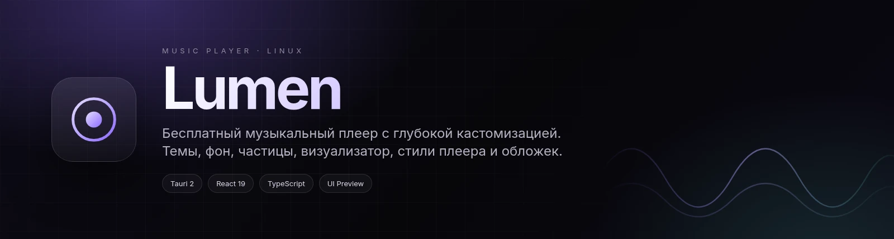
</p>

<h1 align="center">Lumen</h1>

<p align="center">
  <b>Бесплатный музыкальный плеер для Linux с глубокой кастомизацией</b><br/>
  Интерфейс в духе Dotify — но на собственных ассетах, Tauri 2, React 19 и Rust.
</p>

<p align="center">
  
  
  
  
  
  
  
</p>

<p align="center">
  <a href="#возможности">Возможности</a> ·
  <a href="#скриншоты">Скриншоты</a> ·
  <a href="#кастомизация">Кастомизация</a> ·
  <a href="#установка">Установка</a> ·
  <a href="#горячие-клавиши">Горячие клавиши</a> ·
  <a href="#планы">Планы</a>
</p>

---

> [!IMPORTANT]
> Это полноценный музыкальный плеер: SoundCloud и YouTube воспроизводятся через `yt-dlp` + `mpv`, локальная фонотека сканируется по выбранным папкам. Настройки, очередь и библиотека сохраняются в JSON-файлы в папке данных приложения и переживают перезапуск. Сборка стартует с пустой библиотекой — добавьте музыку через поиск или локальные папки.

## Возможности

<table>
<tr>
<td width="50%" valign="top">

**Библиотека и каталог**
- Главная с «Моей волной», статистикой, историей, любимыми и онлайн-источниками
- Живой поиск по трекам, альбомам, артистам и плейлистам
- Глобальный поиск по локальному каталогу, SoundCloud и YouTube
- Плейлисты: создание, переименование, удаление, drag-reorder, свои обложки
- Избранное, история прослушивания, локальная фонотека
- Страницы альбомов и артистов, подписка на артиста

</td>
<td width="50%" valign="top">

**Плеер**
- Очередь, shuffle, repeat / repeat-one, перемотка и громкость
- Скорость воспроизведения и таймер сна с обратным отсчётом
- Мини-плеер: 3 стиля, перетаскивание
- Now Playing: большая обложка, похожие треки, текст из LRCLIB с подсветкой строки
- Контекстное меню, добавление в плейлист, скачивание трека
- Реальное воспроизведение SoundCloud / YouTube и локальных файлов
- Эквалайзер, нормализация, gapless

</td>
</tr>
<tr>
<td valign="top">

**Кастомизация**
- 4 темы + полноценный редактор собственных цветов
- Фон: изображение/GIF, прозрачность, 8 эффектов частиц
- Шрифты, размер, скругления, масштабирование
- Вкладки, панель, обложка, стили плеера и 9 визуализаторов

</td>
<td valign="top">

**Система**
- Собственный frameless titlebar и управление окном
- Рабочие переназначаемые горячие клавиши
- Системный трей, автозапуск, MPRIS и медиаклавиши
- Discord Rich Presence, Last.fm, deep links `lumen://`
- Проверка обновлений и установка из GitHub Releases (в 0.2.0 временно отключена)
- RU / EN / UK, дисковое сохранение настроек и данных

</td>
</tr>
</table>

## Скриншоты

<table>
  <tr>
    <td width="50%">
      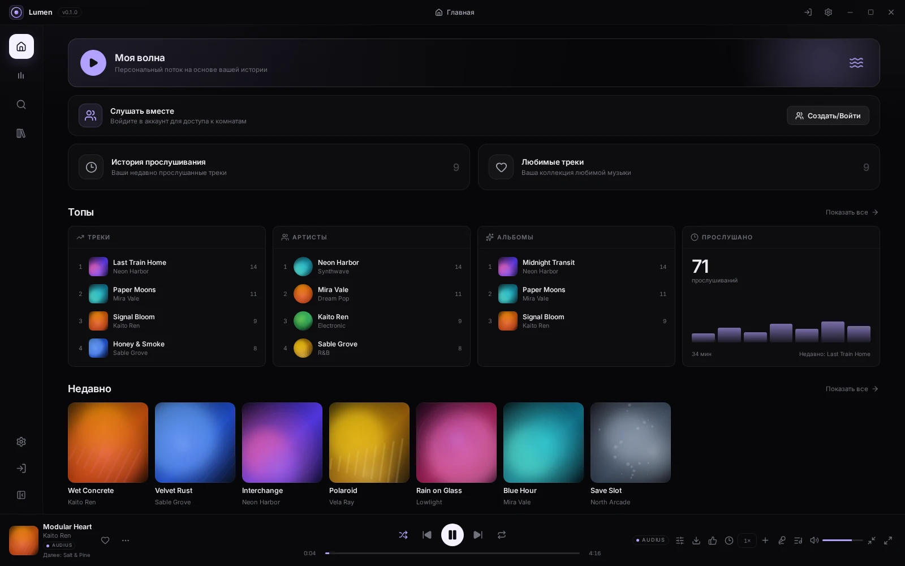
      <br/><sub><b>Главная</b> — «Моя волна», статистика, история и плейлисты</sub>
    </td>
    <td width="50%">
      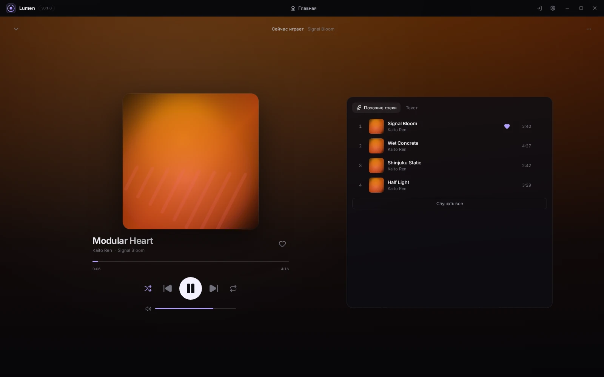
      <br/><sub><b>Now Playing</b> — большая обложка, очередь и похожие треки</sub>
    </td>
  </tr>
  <tr>
    <td width="50%">
      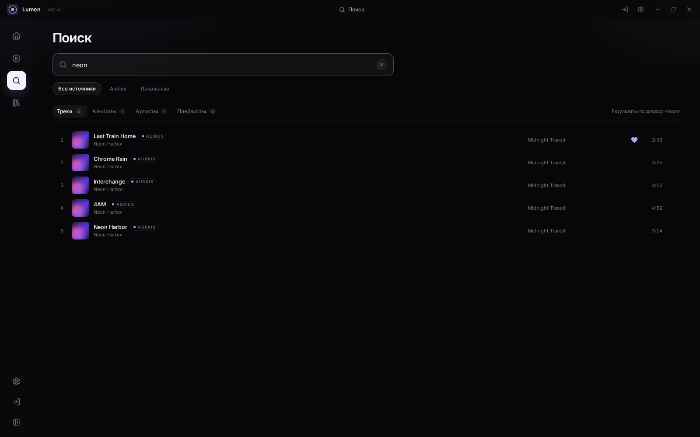
      <br/><sub><b>Поиск</b> — треки, альбомы, артисты и плейлисты</sub>
    </td>
    <td width="50%">
      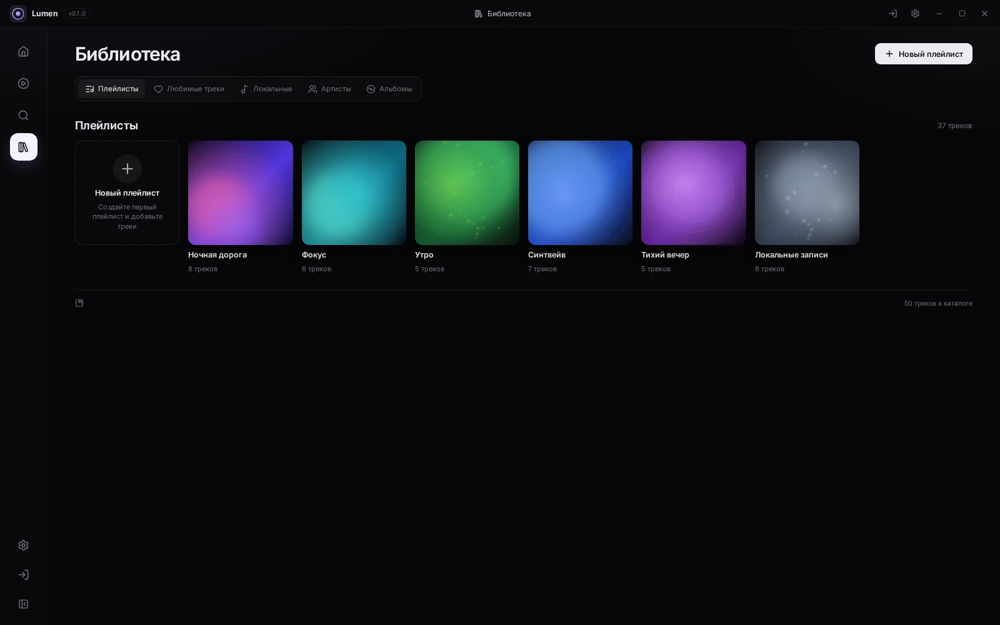
      <br/><sub><b>Библиотека</b> — плейлисты, избранное, локальные треки</sub>
    </td>
  </tr>
  <tr>
    <td width="50%">
      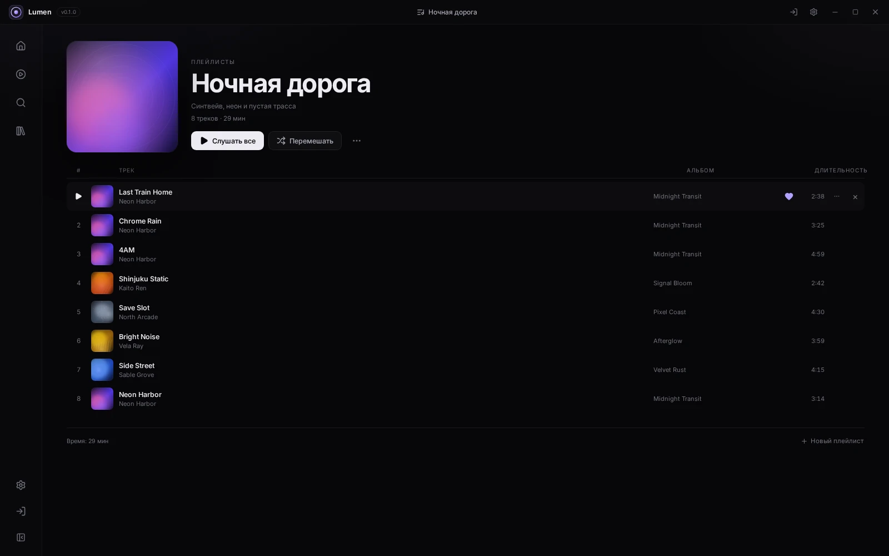
      <br/><sub><b>Плейлист</b> — перестановка треков и общая длительность</sub>
    </td>
    <td width="50%">
      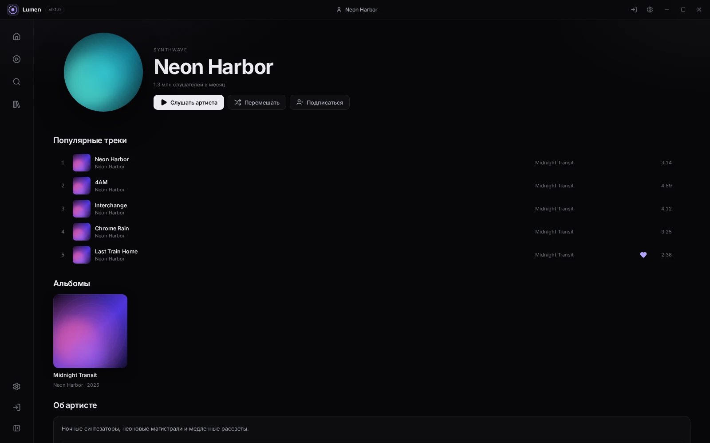
      <br/><sub><b>Артист</b> — популярные треки, альбомы и подписка</sub>
    </td>
  </tr>
  <tr>
    <td width="50%">
      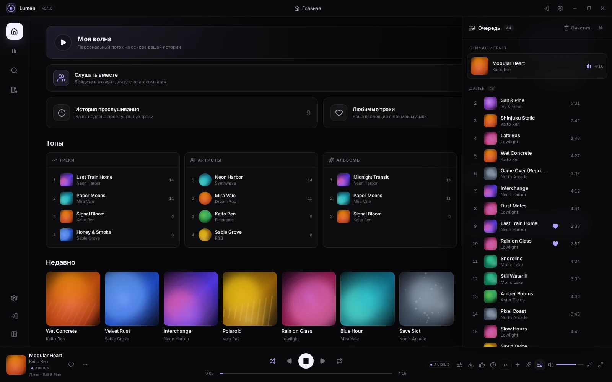
      <br/><sub><b>Очередь</b> — текущий трек и список следующих</sub>
    </td>
    <td width="50%">
      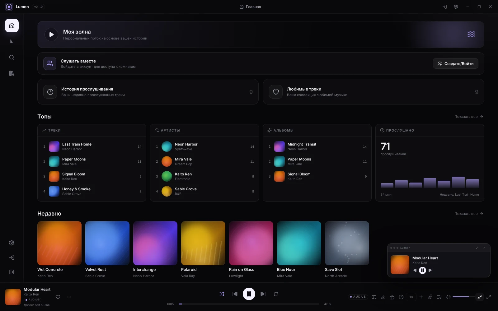
      <br/><sub><b>Мини-плеер</b> — перетаскиваемое окно поверх приложения</sub>
    </td>
  </tr>
</table>

<p align="center">
  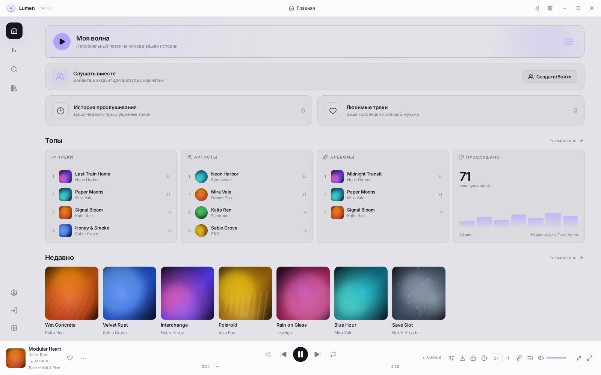
  <br/><sub><b>Светлая тема</b> — один из четырёх пресетов оформления</sub>
</p>

## Кастомизация

В Dotify нравится настраивать всё? Здесь тоже можно. Все параметры применяются сразу и сохраняются между запусками.

<table>
  <tr>
    <td width="50%">
      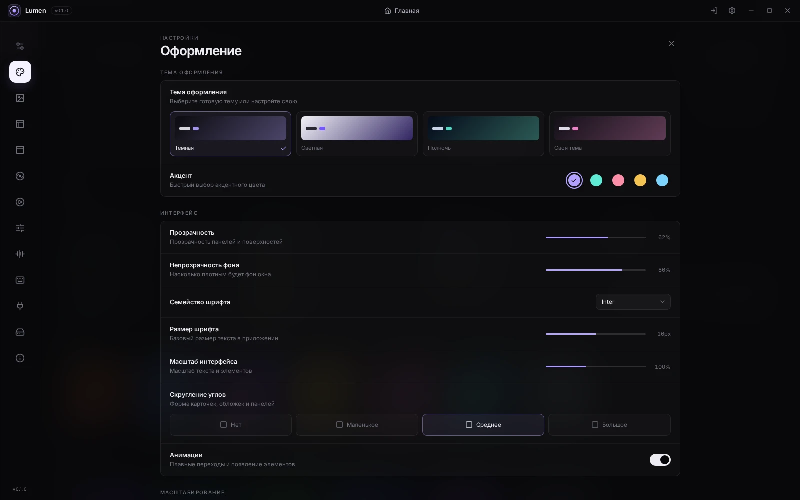
      <br/><sub><b>Оформление</b> — темы, редактор цветов, шрифты, скругления</sub>
    </td>
    <td width="50%">
      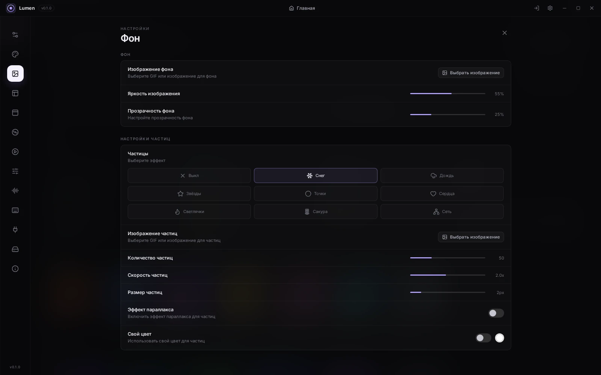
      <br/><sub><b>Фон</b> — изображение/GIF, 8 эффектов частиц и параллакс</sub>
    </td>
  </tr>
  <tr>
    <td width="50%">
      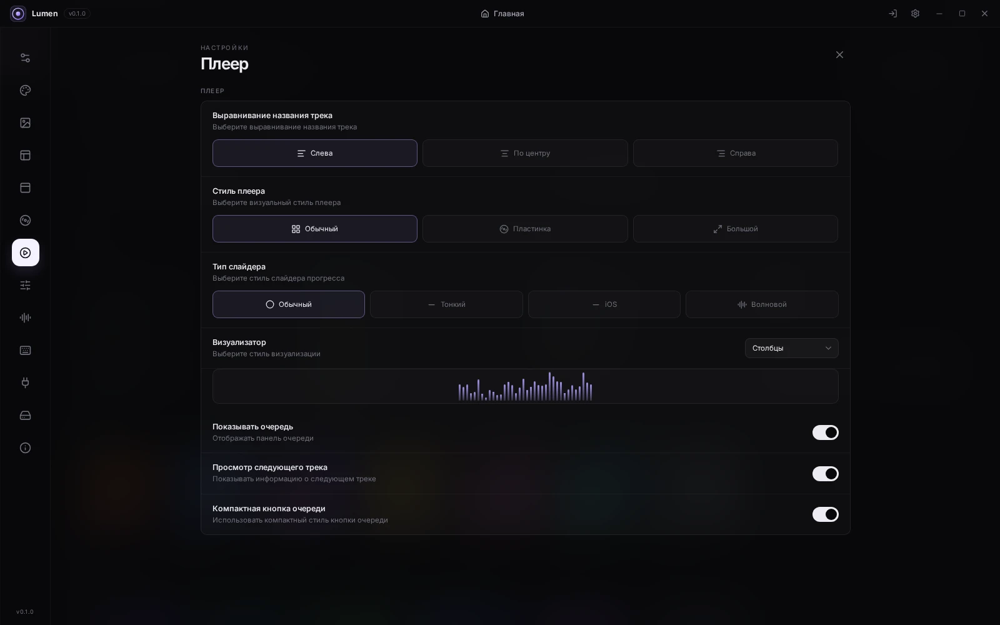
      <br/><sub><b>Плеер</b> — стили, слайдеры и визуализатор с превью</sub>
    </td>
    <td width="50%">
      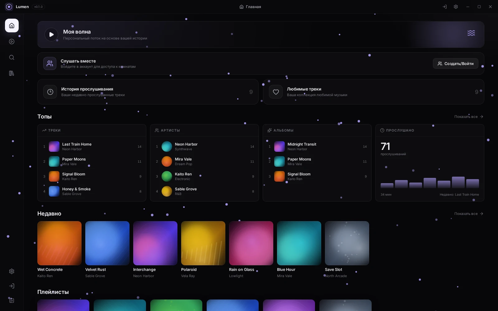
      <br/><sub><b>Частицы</b> — снег, дождь, звёзды, сердца, сакура и сеть</sub>
    </td>
  </tr>
</table>

| Раздел | Что настраивается |
|---|---|
| **Оформление** | 4 темы (тёмная, светлая, полночь, своя), цвета Primary / Accent / Background / Foreground / Card / Border, случайные цвета, 5 акцентов, прозрачность, шрифт, размер, скругления, масштаб окна и фуллскрина |
| **Фон** | своё изображение или GIF, яркость, прозрачность, 8 эффектов частиц, своё изображение частиц, количество, скорость, размер, параллакс, свой цвет |
| **Вкладки** | позиция (сверху/снизу/слева/справа), стиль (по умолчанию/компактный/полный), автоскрытие |
| **Панель** | компактная панель, выбор элементов titlebar (название, свернуть, развернуть, закрепить, закрыть, почта, логотип, версия), автоскрытие |
| **Обложка** | своя обложка, позиция слева/справа, визуализатор поверх обложки, «обложка в обложке» |
| **Плейлисты** | своя обложка у каждого плейлиста, единая обложка для всех, автоматические обложки под цвет темы |
| **Плеер** | выравнивание названия, стиль (обычный / пластинка / большой), тип слайдера (обычный / тонкий / iOS / волновой), 9 визуализаторов, очередь и предпросмотр следующего трека |
| **Кнопки** | любые кнопки плеера: громкость, эквалайзер, полная обложка, плейлист, лайк, источник, таймер сна, скачать, рейтинги, скорость |
| **Мини-плеер** | полный, компактный или минимальный стиль |

## Стек

| Слой | Технологии |
|---|---|
| Оболочка | Tauri 2, Rust, WebKitGTK, собственный frameless titlebar |
| UI | React 19, TypeScript, Vite, Zustand (+ persist), i18next |
| Стили | собственная дизайн-система на CSS-переменных, Inter, lucide-react |
| Обложки | детерминированная генерация SVG в цвете темы — в репозитории нет чужих ассетов |
| Онлайн-источники | `yt-dlp` (поиск и загрузка), `mpv` (воспроизведение), `ffmpeg` (контейнеры) |

## Установка

Нужны Node.js 20+, Rust и системные зависимости Tauri (`webkit2gtk-4.1`, `gtk3`, `libsoup3`).

Для онлайн-источников также нужны `yt-dlp`, `ffmpeg` и `mpv`. Например, в Arch Linux:

```bash
sudo pacman -S yt-dlp ffmpeg mpv
```

`yt-dlp` ищет и скачивает треки, `ffmpeg` помогает с контейнерами, `mpv` воспроизводит аудио. Статус инструментов и размер кэша видны в **Настройки → Интеграции → Источники**.

Для Arch Linux в репозитории есть `packaging/PKGBUILD`: соберите пакет командой `makepkg -si` из папки `packaging`.

Windows-установщик уже содержит `yt-dlp`, `ffmpeg` и `mpv`; при необходимости он также скачивает и устанавливает WebView2. Портативная Windows-сборка поставляется архивом вместе с этими инструментами.

```bash
git clone https://github.com/drkl1enc3/lumen.git
cd lumen
npm install
npm run tauri dev
```

Сборка приложения:

```bash
npm run tauri build
```

Готовые файлы появятся в `src-tauri/target/release/bundle/`:

```
appimage/Lumen_0.2.0_amd64.AppImage   # ~102 MB
deb/Lumen_0.2.0_amd64.deb             # ~3.2 MB
rpm/Lumen-0.2.0-1.x86_64.rpm          # ~3.2 MB
```

Проверка типов и веб-сборка:

```bash
npm run check
npm run build
```

## Интеграции

### Discord Rich Presence

Создайте приложение в [Discord Developer Portal](https://discord.com/developers/applications), скопируйте **Application ID** и вставьте его в **Настройки → Интеграции**. Включать RPC нужно вручную; без корректного ID приложение продолжит работать без Discord.

### Last.fm

Создайте API-приложение на [last.fm/api/account/create](https://www.last.fm/api/account/create), вставьте **API key** и **shared secret** в **Настройки → Интеграции**, нажмите «Подключить» и подтвердите доступ в браузере. После этого Lumen отправляет now playing и scrobble после 50% трека (или 4 минут).

### Deep links и автообновление

Схема `lumen://` регистрируется при установке и в dev-режиме. Примеры: `lumen://track/<id>`, `lumen://playlist/<id>`, `lumen://artist/<id>`.

В сборке **0.2.0 автообновление временно отключено**: релиз публикуется обычными артефактами, `latest.json` и подписи не используются. Новые версии можно скачать со страницы GitHub Releases.

Инфраструктура для будущего включения уже есть в коде. Когда понадобится автообновление, добавьте в секреты GitHub Actions:

- `TAURI_SIGNING_PRIVATE_KEY` — содержимое приватного ключа Tauri Signer
- `TAURI_SIGNING_PRIVATE_KEY_PASSWORD` — пароль ключа

Публичный ключ прописан в `src-tauri/tauri.conf.json`; в конфиге нужно будет снова включить `bundle.createUpdaterArtifacts` и вернуть шаг генерации `latest.json` в release-workflow.

### Где хранятся данные

Настройки, очередь, локальная фонотека и каталог лежат в JSON-файлах в папке данных приложения:

- Linux: `~/.local/share/fun.lumen.app/state/`
- Windows: `%APPDATA%\fun.lumen.app\state\`

Их можно удалить для полного сброса; при следующем запуске приложение создаст чистые файлы.

## Горячие клавиши

| Действие | Клавиши |
|---|---|
| Играть / пауза | `Space` |
| Следующий / предыдущий трек | `Ctrl →` / `Ctrl ←` |
| Громче / тише | `Ctrl ↑` / `Ctrl ↓` |
| Поиск | `Ctrl K` |
| Настройки | `Ctrl ,` |
| Очередь | `Q` |
| Лайк | `L` |
| Закрыть окно / панель | `Esc` |

Все сочетания переназначаются в **Настройки → Горячие клавиши**.

## Структура

```
src/
  layout/        # titlebar, rail, playerbar, очередь, now playing, мини-плеер, настройки
  pages/         # home, search, library, playlist, album, artist, history, favorites, local
  components/    # UI-кит, TrackRow, карточки, диалоги, частицы, визуализатор
  store/         # player, library, settings, ui (zustand + persist)
  lib/           # типы, демо-каталог, источники, каталог внешних треков, аудиомост, темы, Tauri API
src-tauri/       # Rust: команды поиска/кэша/скачивания и mpv IPC
docs/            # скриншоты для README
scripts/         # Playwright-проверки и генерация скриншотов
```

## Планы

- [x] Интерфейс: главная, поиск, библиотека, плейлисты, альбомы, артисты, история
- [x] Плеер, очередь, Now Playing, мини-плеер, контекстные меню
- [x] 13 разделов настроек и глубокая кастомизация
- [x] Темы, фон, частицы, визуализаторы, стили плеера и обложек
- [x] Сборка AppImage / deb / rpm
- [x] Локальные файлы: папки, сканирование, метаданные и воспроизведение
- [x] Дисковое сохранение состояния и миграция из localStorage
- [x] «Моя волна» на локальной истории, тексты LRCLIB
- [x] MPRIS, медиаклавиши, трей, автозапуск, Discord RPC, Last.fm, deep links
- [ ] Автообновление (инфраструктура готова, в 0.2.0 отключено)
- [x] CI и GitHub Releases
- [x] SoundCloud / YouTube: поиск, кэш и воспроизведение через `yt-dlp` + `mpv`

## Правовая рамка

Lumen — самостоятельный клиент. Интерфейс воссоздан по UX-паттернам, но с оригинальными ассетами, иконками и названием; код и ресурсы Dotify не используются.

SoundCloud и YouTube работают через установленные пользователем `yt-dlp` и `mpv`. Приложение не обходит DRM и не открывает доступ к платным каталогам; часть треков SoundCloud доступна только как 30-секундное превью, а YouTube может ограничивать возрастные или региональные видео. Пользователь сам отвечает за соблюдение условий сервисов и локального законодательства. Скачанные для кэша файлы лежат в `~/.cache/lumen/audio` и удаляются из настроек.

## Лицензия

[MIT](LICENSE) © 2026 Lumen

<p align="center"><sub>Сделано на Tauri, React и Rust. Скриншоты — из приложения.</sub></p>
